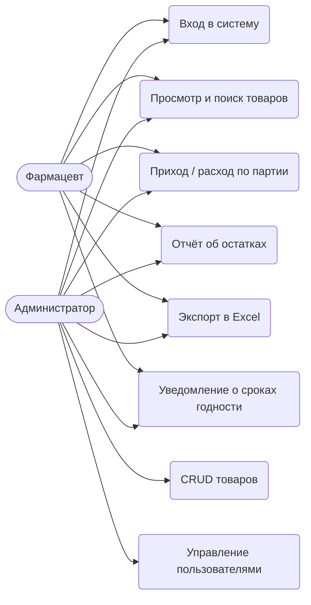
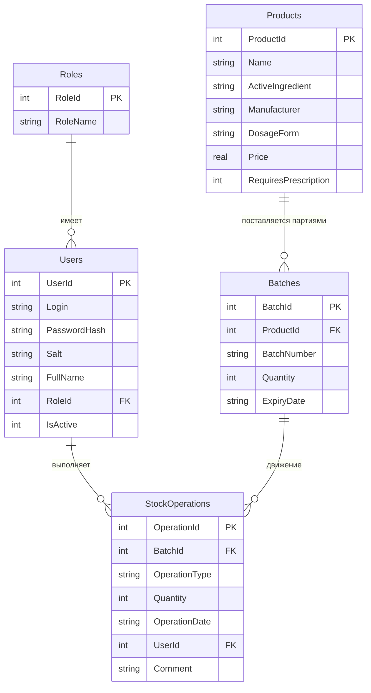

# Пояснительная записка

**Тема:** Информационная система учёта товара на складе аптеки
**Дисциплина:** «Разработка кода информационных систем»
**Платформа:** C#, .NET 8, Windows Forms, SQLite, ClosedXML, xUnit

---

## Введение

В аптеке на складе одновременно хранятся сотни наименований с разными сериями и сроками годности. При ручном учёте (тетради, таблицы) возникают ошибки: неверный остаток, продажа просроченного препарата, невозможность быстро узнать, кто и когда списал товар. Автоматизация учёта решает три задачи: точный остаток по каждой партии, своевременное предупреждение о сроках годности, история всех движений с привязкой к сотруднику.

**Цель работы** — разработать настольное приложение для учёта прихода и расхода товара на складе аптеки с разграничением прав доступа и выгрузкой отчётов в Excel.

**Задачи:**
1. Проанализировать предметную область и описать роли пользователей.
2. Составить техническое задание.
3. Спроектировать базу данных и архитектуру приложения.
4. Реализовать приложение и покрыть бизнес-логику автоматическими тестами.
5. Подготовить документацию.

---

## 1. Анализ предметной области

### 1.1. Бизнес-процесс
Товар поступает на склад партиями (сериями). Каждая партия имеет номер и срок годности. Со склада товар уходит в торговый зал, на аптечные пункты или списывается. Руководству нужны: текущие остатки, перечень партий с истекающим сроком, журнал операций.

### 1.2. Роли
| Роль | Права |
|---|---|
| Администратор | Всё, включая управление пользователями (создание, блокировка, смена пароля) |
| Фармацевт / кладовщик | Просмотр остатков, оформление прихода и расхода, отчёты. Управлять пользователями не может |

Контроль выполняется на двух уровнях: интерфейс скрывает кнопку «Пользователи», а сервис `AuthService` проверяет роль вызывающего и бросает `UnauthorizedAccessException`. Скрытая кнопка — только удобство, настоящая защита — в сервисе (это проверено тестом `Create_ByPharmacist_ThrowsUnauthorized_RBAC`).

### 1.3. Сущности
Товар, Партия, Складская операция, Пользователь, Роль.

### 1.4. Диаграмма вариантов использования


---

## 2. Техническое задание

### 2.1. Функциональные требования
| № | Требование |
|---|---|
| Ф1 | Вход по логину и паролю; заблокированный пользователь войти не может |
| Ф2 | Роли «Администратор» и «Фармацевт» с разными правами |
| Ф3 | CRUD товаров с проверкой обязательных полей; поиск по названию и действующему веществу |
| Ф4 | Создание партий (номер серии, срок годности, начальный остаток) |
| Ф5 | Оформление прихода и расхода с проверкой остатка; запись в журнал с датой, пользователем и комментарием |
| Ф6 | Отчёт «Остатки на складе» со статусами: в норме / истекает скоро / просрочено / нет в наличии |
| Ф7 | Экспорт отчёта в `.xlsx` без установленного Excel |
| Ф8 | Предупреждение о партиях с истёкшим сроком или сроком менее 30 дней |
| Ф9 | Управление пользователями: создание, блокировка/разблокировка, смена пароля (только администратор) |

### 2.2. Бизнес-правила, принятые при проектировании
Эти правила в исходном задании не заданы; они добавлены как разумные для аптеки:
- Нельзя списать больше остатка партии (остаток не может стать отрицательным).
- Нельзя принять на склад партию с уже истёкшим сроком и оформить приход на просроченную партию.
- Расход из просроченной партии возможен только как списание — с обязательной причиной в комментарии.
- Нельзя удалить товар, по которому есть партии (иначе потеряется история).
- Нельзя заблокировать себя и последнего активного администратора (иначе система окажется без управления).
- Номер партии уникален в пределах одного товара.

### 2.3. Нефункциональные требования
Windows, .NET 8; СУБД SQLite (один файл, сервер не нужен); пароли хранятся только в виде хеша SHA-256 с индивидуальной солью; SQL-запросы только параметризованные (защита от SQL-инъекций); бизнес-логика не зависит от WinForms.

### 2.4. Состав форм
`LoginForm`, `MainForm`, `ProductForm` (+ `ProductEditDialog`), `OperationForm` (+ `BatchDialog`), `ReportForm`, `UserForm` (+ `UserEditDialog`).

---

## 3. Проектирование базы данных

### 3.1. ER-диаграмма


### 3.2. Описание таблиц
| Таблица | Назначение | Ограничения |
|---|---|---|
| Roles | Справочник ролей | `RoleName` уникально |
| Users | Учётные записи | `Login` уникален без учёта регистра; хранится хеш и соль, не пароль; `IsActive` 0/1 |
| Products | Номенклатура | `Price >= 0` |
| Batches | Партии | `Quantity >= 0`; пара (`ProductId`, `BatchNumber`) уникальна |
| StockOperations | Журнал | `OperationType` только `IN`/`OUT`; `Quantity > 0`; внешние ключи на партию и пользователя |

Внешние ключи включены явно (`Foreign Keys=True` в строке подключения), потому что в SQLite они по умолчанию **отключены**. Это проверяется тестом `FailedOperation_RollsBack_NoPartialWrite`: запись с несуществующим пользователем отклоняется, остаток не меняется.

Индексы: `Batches(ProductId)`, `Batches(ExpiryDate)`, `StockOperations(BatchId)` — под основные выборки (партии товара, сроки годности, история партии).

### 3.3. Даты в SQLite
Отдельного типа даты нет, поэтому даты хранятся текстом ISO (`yyyy-MM-dd`, время — `yyyy-MM-dd HH:mm:ss`). Такой формат сортируется и сравнивается как строка. Разбор и форматирование всегда выполняются с `CultureInfo.InvariantCulture`, чтобы региональные настройки Windows не ломали данные.

---

## 4. Архитектура

Трёхуровневая структура:
```
PharmacyWarehouse.sln
├── PharmacyWarehouse.UI            — формы (только отображение и ввод)
├── PharmacyWarehouse.Core          — бизнес-логика + доступ к данным
│   ├── Models/        Product, Batch, StockOperation, User, OperationResult
│   ├── Data/          Database (подключение, схема, начальные данные)
│   └── Services/      AuthService, ProductService, StockService, ReportService, PasswordHasher, Session
└── PharmacyWarehouse.Tests         — xUnit
```
Принцип: проект `Core` не ссылается на `System.Windows.Forms`, поэтому все правила проверяются тестами без запуска интерфейса. Сервисы получают `Database` через конструктор; для тестов дополнительно можно подменить «сегодняшнюю дату» (`Func<DateTime>`), иначе тесты сроков годности зависели бы от дня запуска.

Сервисы возвращают `OperationResult` (успех + сообщение для пользователя), а не бросают исключения при обычных ошибках ввода. Исключение (`UnauthorizedAccessException`) — только при нарушении прав, т. к. это ошибка программирования, а не ввода.

### Отличия от шаблона из задания
В примерах из методички есть места, которые в рабочем коде пришлось изменить:
| Было в примере | Проблема | Как сделано |
|---|---|---|
| Проверка остатка отдельным `SELECT`, затем `UPDATE` | Два оператора одновременно могут списать один и тот же остаток | Условие внутри `UPDATE ... WHERE Quantity >= @q`; результат — `ExecuteNonQuery() == 0` → «недостаточно». Проверено тестом с 10 параллельными списаниями |
| `return` внутри `try` без отката | Транзакция остаётся открытой | Явный `Commit`/`Rollback` по результату |
| Тест на `Data Source=:memory:` | У каждого подключения своя пустая БД в памяти, схема «пропадает» | Временный файл на каждый тест, удаляется после |
| `date('now', '+' \|\| @days \|\| ' days')` | Зависит от системных часов, не тестируется | Граница считается в C# от внедряемой даты |
| `LIKE` для поиска | В SQLite нечувствителен к регистру только для латиницы: «нуро» не находил «Нурофен» | Фильтрация в C# (`InvariantCultureIgnoreCase`). Ошибка обнаружена тестом `Search_FindsByNameAndIngredient` |

---

## 5. Реализация

Ключевые фрагменты (полные исходники — в `src/`):

**Хеширование пароля.** Для каждого пароля генерируется 16 случайных байт соли; хеш — SHA-256 от «пароль + соль». Сравнение хешей — `CryptographicOperations.FixedTimeEquals` (за постоянное время). Один и тот же пароль у двух пользователей даёт разные хеши (тест `PasswordHasher_SamePassword_DifferentSaltsAndVerifies`). Примечание: для реальной системы стандартом считаются медленные алгоритмы (PBKDF2, Argon2); SHA-256 с солью использован, потому что так требует ТЗ.

**Операция прихода/расхода** (`StockService.RegisterOperation`): валидация типа и количества → проверка срока годности → атомарный `UPDATE` остатка → запись в журнал, всё в одной транзакции; при любом сбое — откат.

**Предупреждения о сроках** (`StockService.GetExpiringBatches`): партии с остатком > 0, у которых срок ≤ сегодня + 30 дней; просроченные помечаются отдельно.

**Экспорт в Excel** (`ReportService.ExportToExcel`): ClosedXML; числа пишутся как числа (а не строки), чтобы в Excel работали сортировка и формулы.

**Интерфейс:** формы строятся кодом (без дизайнера), стандартные элементы — `DataGridView`, `ComboBox`, `NumericUpDown`, `SaveFileDialog`. Строки отчёта подсвечиваются по статусу (красный — просрочено, жёлтый — истекает скоро, серый — нет в наличии).

---

## 6. Тестирование

### 6.1. Автоматические тесты (xUnit, 44 теста, все проходят)
| Группа | Что проверяется |
|---|---|
| `AuthTests` (17 проверок) | Хеширование и соль; вход; регистр логина; пароль не хранится открытым текстом; создание пользователя; **RBAC** (фармацевт получает исключение); дубликат логина; некорректный ввод; блокировка/разблокировка; нельзя заблокировать себя и последнего администратора; смена пароля |
| `ProductTests` (7) | Валидация; полный цикл добавить → прочитать → изменить → удалить; запрет удаления товара с партиями; поиск; изменение несуществующего |
| `StockTests` (17) | Нулевое и отрицательное количество; расход больше остатка (остаток и журнал не меняются); неизвестный тип; неизвестная партия; остаток после серии операций; запись в журнал; просроченные партии (приход, расход, списание, создание); дубликат номера партии; валидация партии; выборка истекающих (в т. ч. граничный день 30/31); откат при ошибке внешнего ключа; **параллельное списание — остаток не уходит в минус** |
| `ReportTests` (3) | Статусы и суммы в сводке; содержимое `.xlsx` (заголовок жирный, числа — числа); пустая таблица |

Запуск: `dotnet test` → `Passed: 44, Failed: 0`.

### 6.2. Найденные и исправленные дефекты
1. **Поиск по кириллице** без учёта регистра не работал (`LIKE` в SQLite) — найден тестом, исправлен переносом фильтра в C#.
2. **Создание просроченной партии с остатком** давало невнятную ошибку из операции прихода — добавлена явная проверка в `AddBatch` с понятным сообщением и тест.

### 6.3. Ручное тестирование интерфейса — не выполнено
Приложение Windows Forms не запускалось: разработка велась на Linux без Windows. Исходный код интерфейса успешно **компилируется** (проверено против справочных сборок WinForms), но визуально формы, вёрстка и сценарии кликов не проверены. Перед защитой нужно на Windows пройти чек-лист из раздела 3 руководства пользователя и приложить скриншоты. Это единственное существенное неподтверждённое место работы.

---

## Заключение

Разработана система учёта товара на складе аптеки: БД из 5 таблиц с внешними ключами, авторизация с хешированием паролей, две роли с проверкой на уровне сервисов, CRUD товаров, приход/расход по партиям с журналом, отчёт и экспорт в Excel, уведомления о сроках годности, 44 автоматических теста.

**Направления развития:** штрих-кодирование и сканер; интеграция с 1С; медленный алгоритм хеширования паролей (PBKDF2/Argon2); отдельная операция «списание» с причинами вместо комментария; ограничение по рецептурным препаратам; резервное копирование БД; миграции схемы.

## Список литературы
1. Microsoft Learn. Документация C# и .NET 8 — learn.microsoft.com/dotnet
2. Microsoft Learn. Windows Forms — learn.microsoft.com/dotnet/desktop/winforms
3. Microsoft Learn. Microsoft.Data.Sqlite — learn.microsoft.com/dotnet/standard/data/sqlite
4. SQLite Documentation: Foreign Key Support; Date And Time Functions; LIKE — sqlite.org/docs.html
5. ClosedXML — github.com/ClosedXML/ClosedXML
6. xUnit.net — xunit.net
7. ГОСТ 19.201-78. ЕСПД. Техническое задание. Требования к содержанию и оформлению.

## Приложения
- Приложение А. Исходный код — каталог `src/`.
- Приложение Б. Тесты — каталог `tests/`.
- Приложение В. Руководство пользователя — `docs/Руководство_пользователя.md`.
