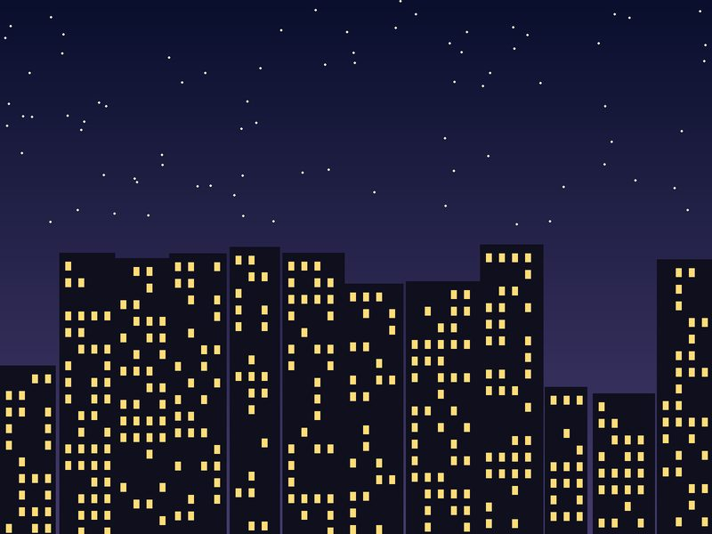

# Отчёт по практическому занятию № 19

**Тема:** Интеграция графики. Публикация обработанной графической информации и ведение информационных баз медиафайлов с HTML, CSS, JS
**Студент:** _фамилия, группа_ · **Дата:** 24.11.2026

## 1. Что сделано
| Задание | Реализация | Файл |
|---|---|---|
| 1. Адаптивная галерея | 6 изображений, CSS Grid `auto-fill/minmax(220px,1fr)`, `object-fit: cover`, `aspect-ratio: 4/3`; проверено на 1200, 768 и 375 px | `index.html`, `style.css` |
| 2. Фильтры на Canvas | Загрузка через `FileReader`, фильтры: чёрно-белое (формула яркости), сепия, негатив, контраст; сброс | `app.js` |
| 3. Публикация | `toDataURL` → `` в галерее; кнопка «Загрузить на сервер» (`Blob` → `FormData` → `fetch`), при недоступном сервере выводится содержимое `FormData` | `app.js` |
| 4. IndexedDB | add/getAll/put/delete, удаление по `id`, «Очистить базу», сортировка от новых к старым через индекс `createdAt` | `app.js` |

Запуск: любой локальный сервер, например `python3 -m http.server`, затем открыть `http://localhost:8000/`. (Live Server из VS Code тоже подходит.)

## 2. Скриншоты (папка `screens/`)
- Галерея: `gallery_1200.png` (4 колонки), `gallery_768.png` (3), `gallery_375.png` (1).
- Применённый фильтр: `filter_grayscale.png`.
- Публикация и вывод FormData: `publish_upload.png`.
- Галерея из базы: `indexeddb_gallery.png`. Мобильный вид: `mobile_375.png`.
- Содержимое хранилища IndexedDB: `indexeddb_store.png`. **Это снимок, построенный скриптом из результата `getAll()`, а не вкладка Application в DevTools:** DevTools в среде выполнения недоступен. Для сдачи сделайте настоящий скриншот: F12 → Application → IndexedDB → MediaGalleryDB → media.

## 3. Отличия от кода из методички и почему
Код из описания занятия работает, но в нём есть места, которые на практике ломаются; они исправлены:
1. **`height: 200px` вместе с `aspect-ratio: 4/3`.** Заданная высота отменяет `aspect-ratio`: карточки получат фиксированные 200 px и разные пропорции на разной ширине. В моём CSS высота не задана, пропорция 4:3 держится на всех ширинах (проверено измерением).
2. **Фильтр применялся один раз и без отката.** Добавлены сброс к исходнику (`ImageData` хранится отдельно) и накопление фильтров.
3. **Большие фото.** Снимок 4000×3000 даёт массив в 48 МБ для `getImageData`; изображение уменьшается до 1600 px по длинной стороне.
4. **`FormData` в методичке без обработки ошибок.** Добавлены `try/catch`, запасной вывод содержимого `FormData` и `console.log`.
5. **Подключение к IndexedDB открывалось при каждой операции.** Теперь одно общее подключение (`dbPromise`), а результат ждёт `tx.oncomplete`, а не только `request.onsuccess`, иначе запись могла бы ещё не зафиксироваться.
6. **Сортировка.** Вместо `getAll()` и сортировки в JS использован индекс `createdAt` с курсором `openCursor(null, "prev")`. Время хранится как ISO-строка, она сортируется лексикографически правильно.
7. **Сохранение в базу из `toBlob`**, а не из Data URL: не нужно base64 (+33 % размера) и лишнее преобразование.
8. **Утечка объектных URL.** `revokeObjectURL` вызывается и в `onload`, и в `onerror`.
9. **Безопасность.** Имена и описания пользователя вставляются через `textContent`/`alt`, а не `innerHTML`.
10. **Доступность.** У изображений осмысленные `alt`, кнопки удаления с `aria-label`, статусы в `aria-live`, видимый фокус, учтён `prefers-reduced-motion`.
11. **Недоступная база** (например, приватный режим): раздел отключается, пользователь видит сообщение, страница не падает.

## 4. Проверка
Автоматическая проверка в Chromium (Playwright) выполнила сценарий целиком и подтвердила: 6 изображений; нет горизонтальной прокрутки на 1200/768/375 px; соотношение карточек 4:3 на всех ширинах; отказ для не-изображения и повреждённого файла; ч/б даёт R=G=B; сброс возвращает исходные пиксели; двойной негатив равен оригиналу; публикация и `alt`; в базе 4 записи (разные фильтры), порядок от новых к старым, индексы `createdAt` и `type`, MIME `image/jpeg` и `Blob`; удаление по `id`; данные переживают перезагрузку; очистка базы.

**Что не проверялось:** реальная загрузка на сервер (серверной части нет, работает запасной вариант); другие браузеры, кроме Chromium; большие фото ≥ 12 Мпикс.
Отдельно: в консоли при загрузке на сервер виден ответ статического сервера 501 на POST. Это ожидаемо и обрабатывается.

Использованные картинки — не фотографии: их нарисовал Python-скрипт (Pillow), чтобы не зависеть от чужих авторских прав.

## 5. Листинги
### index.html
```html
<!DOCTYPE html>
<html lang="ru">
<head>
<meta charset="utf-8">
<meta name="viewport" content="width=device-width, initial-scale=1">
<title>Интеграция графики: галерея, Canvas, IndexedDB</title>
<link rel="stylesheet" href="style.css">
</head>
<body>
<header class="page-head">
  <h1>Интеграция графики</h1>
  <p>Адаптивная галерея, обработка изображений на Canvas, публикация и локальная база медиафайлов (IndexedDB)</p>
</header>

<main>
  <!-- ЗАДАНИЕ 1 -->
  <section aria-labelledby="t1">
    <h2 id="t1">1. Адаптивная галерея</h2>
    <div class="gallery" id="gallery">
      <figure class="gallery-item"><figcaption class="caption">Закат</figcaption></figure>
      <figure class="gallery-item"><figcaption class="caption">Горы</figcaption></figure>
      <figure class="gallery-item"><figcaption class="caption">Море</figcaption></figure>
      <figure class="gallery-item"><figcaption class="caption">Лес</figcaption></figure>
      <figure class="gallery-item"><figcaption class="caption">Ночной город</figcaption></figure>
      <figure class="gallery-item"><figcaption class="caption">Пустыня</figcaption></figure>
    </div>
    <p class="hint">Изображения созданы скриптом (Python/Pillow), это не фотографии.</p>
  </section>

  <!-- ЗАДАНИЕ 2 -->
  <section aria-labelledby="t2">
    <h2 id="t2">2. Обработка изображения на Canvas</h2>
    <div class="toolbar">
      <label class="file-label">Выберите изображение:
        <input type="file" id="fileInput" accept="image/*">
      </label>
    </div>
    <div class="toolbar" role="group" aria-label="Фильтры">
      <button type="button" data-filter="grayscale" disabled>Чёрно-белое</button>
      <button type="button" data-filter="sepia" disabled>Сепия</button>
      <button type="button" data-filter="invert" disabled>Негатив</button>
      <button type="button" data-filter="contrast" disabled>Контраст +</button>
      <button type="button" id="resetBtn" disabled>Сбросить</button>
    </div>
    <div class="canvas-wrap">
      <canvas id="canvas" aria-label="Редактируемое изображение" role="img"></canvas>
      <p id="canvasEmpty" class="hint">Изображение не выбрано.</p>
    </div>
    <p id="filterInfo" class="hint" aria-live="polite"></p>
  </section>

  <!-- ЗАДАНИЕ 3 -->
  <section aria-labelledby="t3">
    <h2 id="t3">3. Публикация обработанного изображения</h2>
    <div class="toolbar">
      <button type="button" id="publishBtn" disabled>Опубликовать в галерее</button>
      <button type="button" id="uploadBtn" disabled>Загрузить на сервер</button>
    </div>
    <div class="gallery" id="previewContainer" aria-label="Опубликованные изображения"></div>
    <pre id="uploadResult" class="log" aria-live="polite" hidden></pre>
  </section>

  <!-- ЗАДАНИЕ 4 -->
  <section aria-labelledby="t4">
    <h2 id="t4">4. База медиафайлов (IndexedDB)</h2>
    <form id="saveForm" class="save-form">
      <label>Название <input type="text" id="nameInput" maxlength="80" placeholder="например, закат_чб"></label>
      <label>Описание (используется как alt) <input type="text" id="descInput" maxlength="200" placeholder="Что на изображении"></label>
      <button type="submit" id="saveBtn" disabled>Сохранить в базу</button>
    </form>
    <div class="toolbar">
      <button type="button" id="clearDbBtn">Очистить базу</button>
      <span id="dbStats" class="hint" aria-live="polite"></span>
    </div>
    <div class="gallery" id="dbGallery" aria-label="Изображения из базы"></div>
    <p id="dbEmpty" class="hint" hidden>В базе пока нет изображений.</p>
  </section>
</main>

<div id="status" class="status" role="status" aria-live="polite"></div>
<footer class="page-foot">Практическое занятие «Интеграция графики» · HTML, CSS, JavaScript</footer>
<script src="app.js"></script>
</body>
</html>
```

### style.css
```css
:root {
  --bg: #f6f7f9; --card: #fff; --text: #1d2733; --muted: #4b5866; --accent: #1a5fb4; --accent-dark: #14498a;
  --border: #d5dbe3; --danger: #b3261e;
}
* { box-sizing: border-box; }
body { margin: 0; font: 16px/1.55 system-ui, "Segoe UI", Roboto, Arial, sans-serif; color: var(--text); background: var(--bg); }
img, canvas { max-width: 100%; height: auto; }

.page-head { background: var(--accent); color: #fff; padding: 28px 20px; text-align: center; }
.page-head h1 { margin: 0 0 6px; font-size: 1.9rem; }
.page-head p { margin: 0 auto; max-width: 720px; }

main { max-width: 1100px; margin: 0 auto; padding: 16px; }
section { background: var(--card); border: 1px solid var(--border); border-radius: 10px; padding: 16px 20px 20px; margin: 20px 0; }
h2 { margin: 0 0 12px; font-size: 1.35rem; }
.hint { color: var(--muted); font-size: .92rem; margin: 8px 0; }

/* Галерея: автоматическое число колонок */
.gallery { display: grid; grid-template-columns: repeat(auto-fill, minmax(220px, 1fr)); gap: 16px; padding: 8px 0; }
.gallery-item { margin: 0; position: relative; }
.gallery-item img {
  display: block; width: 100%;
  aspect-ratio: 4 / 3;          /* единое соотношение; высота не задаётся, чтобы aspect-ratio работал */
  object-fit: cover;            /* без искажений: лишнее обрезается */
  border-radius: 8px; transition: transform .2s, box-shadow .2s; background: #e6e9ee;
}
.gallery-item img:hover { transform: scale(1.03); box-shadow: 0 4px 12px rgba(0,0,0,.2); }
.caption { text-align: center; font-size: .9rem; color: var(--muted); margin-top: 6px; overflow-wrap: anywhere; }
@media (prefers-reduced-motion: reduce) { .gallery-item img { transition: none; } .gallery-item img:hover { transform: none; } }

.toolbar { display: flex; flex-wrap: wrap; gap: 8px; align-items: center; margin: 8px 0; }
button { font: inherit; padding: 8px 14px; border: 1px solid var(--accent); background: var(--accent); color: #fff; border-radius: 6px; cursor: pointer; }
button:hover:not(:disabled) { background: var(--accent-dark); }
button:disabled { background: #c9d0d9; border-color: #c9d0d9; color: #4b5866; cursor: not-allowed; }
button.danger { background: var(--danger); border-color: var(--danger); }
button:focus-visible, input:focus-visible { outline: 3px solid #f5a623; outline-offset: 2px; }
#clearDbBtn { background: #fff; color: var(--danger); border-color: var(--danger); }
#clearDbBtn:hover:not(:disabled) { background: #fdecea; }

.canvas-wrap { border: 1px dashed var(--border); border-radius: 8px; padding: 8px; text-align: center; background: #fafbfc; min-height: 80px; }
#canvas { display: none; max-width: 100%; height: auto; border-radius: 4px; }
#canvas.on { display: inline-block; }

.save-form { display: grid; grid-template-columns: 1fr 2fr auto; gap: 10px; align-items: end; }
.save-form label { display: flex; flex-direction: column; font-size: .92rem; color: var(--muted); }
input[type=text] { font: inherit; padding: 8px; border: 1px solid var(--border); border-radius: 6px; color: var(--text); }
input[type=file] { font: inherit; }

.item-delete { position: absolute; top: 6px; right: 6px; padding: 2px 9px; font-size: 1.1rem; line-height: 1.3; background: rgba(179,38,30,.92); border-color: transparent; }
.meta { font-size: .8rem; color: var(--muted); text-align: center; overflow-wrap: anywhere; }

.log { background: #1f2933; color: #e6edf3; padding: 12px; border-radius: 8px; overflow-x: auto; white-space: pre-wrap; font-size: .85rem; }
.status { position: fixed; left: 50%; bottom: 16px; transform: translateX(-50%); max-width: calc(100% - 32px); background: #1f2933; color: #fff; padding: 10px 16px; border-radius: 8px; opacity: 0; pointer-events: none; transition: opacity .25s; }
.status.show { opacity: 1; }
.status.error { background: var(--danger); }
.page-foot { text-align: center; color: var(--muted); font-size: .85rem; padding: 20px; }

@media (max-width: 720px) {
  .save-form { grid-template-columns: 1fr; }
  .page-head h1 { font-size: 1.5rem; }
  section { padding: 12px; }
}
```

### app.js
```javascript
'use strict';

/* ============ Общие помощники ============ */
const $ = (id) => document.getElementById(id);

const fileInput = $('fileInput');
const canvas = $('canvas');
const ctx = canvas.getContext('2d', { willReadFrequently: true });
const canvasEmpty = $('canvasEmpty');
const filterButtons = [...document.querySelectorAll('button[data-filter]')];
const resetBtn = $('resetBtn');
const publishBtn = $('publishBtn');
const uploadBtn = $('uploadBtn');
const saveBtn = $('saveBtn');
const previewContainer = $('previewContainer');
const uploadResult = $('uploadResult');
const filterInfo = $('filterInfo');

const MAX_SIDE = 1600;       // большие фото уменьшаем: getImageData по 20 Мпикс тормозит и съедает память
let originalData = null;     // ImageData исходного изображения (для сброса)
let sourceName = '';
let appliedFilters = [];     // какие фильтры уже применены (для подписи и записи в БД)

let statusTimer = 0;
function showStatus(text, isError = false) {
  const el = $('status');
  el.textContent = text;
  el.classList.toggle('error', isError);
  el.classList.add('show');
  clearTimeout(statusTimer);
  statusTimer = setTimeout(() => el.classList.remove('show'), 3500);
}

function setEditorEnabled(on) {
  filterButtons.forEach((b) => (b.disabled = !on));
  [resetBtn, publishBtn, uploadBtn, saveBtn].forEach((b) => (b.disabled = !on));
}

function canvasToBlob(type = 'image/jpeg', quality = 0.9) {
  return new Promise((resolve, reject) =>
    canvas.toBlob((b) => (b ? resolve(b) : reject(new Error('Не удалось получить изображение из canvas'))), type, quality));
}

function describeFilters() {
  return appliedFilters.length ? appliedFilters.map((f) => FILTER_TITLES[f]).join(' + ') : 'без фильтров';
}

/* ============ Задание 2: загрузка и фильтры Canvas ============ */
const FILTER_TITLES = { grayscale: 'чёрно-белое', sepia: 'сепия', invert: 'негатив', contrast: 'контраст' };

const FILTERS = {
  // Формула яркости (luminance), коэффициенты ITU-R BT.601
  grayscale(d) {
    for (let i = 0; i < d.length; i += 4) {
      const g = 0.299 * d[i] + 0.587 * d[i + 1] + 0.114 * d[i + 2];
      d[i] = d[i + 1] = d[i + 2] = g;
    }
  },
  sepia(d) {
    for (let i = 0; i < d.length; i += 4) {
      const r = d[i], g = d[i + 1], b = d[i + 2];
      d[i] = 0.393 * r + 0.769 * g + 0.189 * b;      // Uint8ClampedArray сам ограничивает значения 0..255
      d[i + 1] = 0.349 * r + 0.686 * g + 0.168 * b;
      d[i + 2] = 0.272 * r + 0.534 * g + 0.131 * b;
    }
  },
  invert(d) {
    for (let i = 0; i < d.length; i += 4) {
      d[i] = 255 - d[i]; d[i + 1] = 255 - d[i + 1]; d[i + 2] = 255 - d[i + 2];   // альфа не трогаем
    }
  },
  contrast(d, k = 1.3) {
    for (let i = 0; i < d.length; i += 4) {
      d[i] = (d[i] - 128) * k + 128; d[i + 1] = (d[i + 1] - 128) * k + 128; d[i + 2] = (d[i + 2] - 128) * k + 128;
    }
  },
};

fileInput.addEventListener('change', (e) => {
  const file = e.target.files[0];
  if (!file) return;
  if (!file.type.startsWith('image/')) {
    showStatus('Выбранный файл не является изображением.', true);
    fileInput.value = '';
    return;
  }
  const reader = new FileReader();
  reader.onerror = () => showStatus('Не удалось прочитать файл.', true);
  reader.onload = (event) => {
    const img = new Image();
    img.onerror = () => showStatus('Файл повреждён или имеет неподдерживаемый формат.', true);
    img.onload = () => {
      const scale = Math.min(1, MAX_SIDE / Math.max(img.naturalWidth, img.naturalHeight));
      canvas.width = Math.round(img.naturalWidth * scale);
      canvas.height = Math.round(img.naturalHeight * scale);
      ctx.drawImage(img, 0, 0, canvas.width, canvas.height);
      originalData = ctx.getImageData(0, 0, canvas.width, canvas.height);
      sourceName = file.name.replace(/\.[^.]+$/, '');
      appliedFilters = [];
      canvas.classList.add('on');
      canvasEmpty.hidden = true;
      canvas.setAttribute('aria-label', `Редактируемое изображение: ${file.name}`);
      $('nameInput').value = sourceName;
      setEditorEnabled(true);
      updateFilterInfo(scale < 1 ? ` Размер уменьшен до ${canvas.width}×${canvas.height}.` : '');
    };
    img.src = event.target.result;
  };
  reader.readAsDataURL(file);
});

function updateFilterInfo(extra = '') {
  filterInfo.textContent = `Применено: ${describeFilters()}.${extra}`;
}

filterButtons.forEach((btn) =>
  btn.addEventListener('click', () => {
    if (!originalData) return;
    const name = btn.dataset.filter;
    // Фильтры накапливаются: данные берём с canvas (а не из исходника), чтобы можно было комбинировать.
    const imageData = ctx.getImageData(0, 0, canvas.width, canvas.height);
    FILTERS[name](imageData.data);
    ctx.putImageData(imageData, 0, 0);
    appliedFilters.push(name);
    updateFilterInfo();
  }));

resetBtn.addEventListener('click', () => {
  if (!originalData) return;
  ctx.putImageData(originalData, 0, 0);
  appliedFilters = [];
  updateFilterInfo();
});

/* ============ Задание 3: публикация и загрузка на сервер ============ */
publishBtn.addEventListener('click', () => {
  // Data URL: пригоден для немедленного показа в 
  const dataURL = canvas.toDataURL('image/jpeg', 0.9);
  const item = document.createElement('figure');
  item.className = 'gallery-item';
  const img = document.createElement('img');
  img.src = dataURL;
  img.alt = `Обработанное изображение «${sourceName}» (${describeFilters()})`;
  img.width = canvas.width; img.height = canvas.height;
  const cap = document.createElement('figcaption');
  cap.className = 'caption';
  cap.textContent = `${sourceName}: ${describeFilters()}`;
  const del = document.createElement('button');
  del.type = 'button'; del.className = 'item-delete danger';
  del.textContent = '×'; del.setAttribute('aria-label', 'Убрать из галереи');
  del.addEventListener('click', () => item.remove());
  item.append(img, cap, del);
  previewContainer.appendChild(item);
  showStatus('Изображение опубликовано в галерее.');
});

async function uploadToServer(blob, filename) {
  const formData = new FormData();
  formData.append('file', blob, filename);
  formData.append('filters', describeFilters());
  const response = await fetch('/api/upload', { method: 'POST', body: formData });
  if (!response.ok) throw new Error(`Сервер ответил ${response.status}`);
  return { formData, json: await response.json() };      // сервер должен вернуть, например, { "url": "..." }
}

uploadBtn.addEventListener('click', async () => {
  uploadBtn.disabled = true;
  uploadResult.hidden = false;
  const filename = `edited_${Date.now()}.jpg`;
  let blob;
  try {
    blob = await canvasToBlob();
    const { json } = await uploadToServer(blob, filename);
    uploadResult.textContent = `Файл загружен. URL: ${json.url ?? json.id ?? JSON.stringify(json)}`;
    showStatus('Файл загружен на сервер.');
  } catch (err) {
    // Серверной части в этой работе нет — показываем, что именно было бы отправлено (допускается заданием).
    const fd = new FormData();
    if (blob) { fd.append('file', blob, filename); fd.append('filters', describeFilters()); }
    const lines = [`Сервер недоступен (${err.message}). Сформирован FormData (multipart/form-data):`];
    for (const [key, value] of fd.entries()) {
      lines.push(value instanceof File
        ? `  ${key} = File { name: "${value.name}", type: "${value.type}", size: ${value.size} байт }`
        : `  ${key} = "${value}"`);
    }
    uploadResult.textContent = lines.join('\n');
    console.log(lines.join('\n'));
    showStatus('Сервер недоступен: показано содержимое FormData.', true);
  } finally {
    uploadBtn.disabled = !originalData;
  }
});

/* ============ Задание 4: IndexedDB ============ */
const DB_NAME = 'MediaGalleryDB';
const DB_VERSION = 1;
const STORE = 'media';
let dbPromise = null;

function openDB() {
  if (!('indexedDB' in window)) return Promise.reject(new Error('IndexedDB не поддерживается'));
  // Одно подключение на всё приложение: не открываем базу заново при каждой операции
  dbPromise ??= new Promise((resolve, reject) => {
    const request = indexedDB.open(DB_NAME, DB_VERSION);
    request.onupgradeneeded = (e) => {
      const db = e.target.result;
      if (!db.objectStoreNames.contains(STORE)) {
        const store = db.createObjectStore(STORE, { keyPath: 'id', autoIncrement: true });
        store.createIndex('createdAt', 'createdAt');
        store.createIndex('type', 'type');
      }
    };
    request.onsuccess = (e) => resolve(e.target.result);
    request.onerror = (e) => { dbPromise = null; reject(e.target.error); };
  });
  return dbPromise;
}

/** Выполняет запрос и ждёт завершения транзакции (а не только успеха запроса). */
async function runTx(mode, work) {
  const db = await openDB();
  return new Promise((resolve, reject) => {
    const tx = db.transaction(STORE, mode);
    let result;
    const req = work(tx.objectStore(STORE));
    if (req) req.onsuccess = () => { result = req.result; };
    tx.oncomplete = () => resolve(result);
    tx.onerror = () => reject(tx.error);
    tx.onabort = () => reject(tx.error || new Error('Транзакция отменена'));
  });
}

async function saveMedia(blob, metadata = {}) {
  const record = {
    blob,
    type: blob.type,
    name: metadata.name || `media_${Date.now()}`,
    description: metadata.description || '',
    filters: metadata.filters || [],
    width: metadata.width || 0,
    height: metadata.height || 0,
    createdAt: new Date().toISOString(),
    size: blob.size,
  };
  return runTx('readwrite', (store) => store.add(record));
}

const deleteMedia = (id) => runTx('readwrite', (store) => store.delete(id));
const clearMedia = () => runTx('readwrite', (store) => store.clear());
const countMedia = () => runTx('readonly', (store) => store.count());

/** Все записи от новых к старым — через индекс createdAt и курсор в обратном порядке. */
async function getAllNewestFirst() {
  const db = await openDB();
  return new Promise((resolve, reject) => {
    const records = [];
    const tx = db.transaction(STORE, 'readonly');
    const cursorReq = tx.objectStore(STORE).index('createdAt').openCursor(null, 'prev');
    cursorReq.onsuccess = () => {
      const cursor = cursorReq.result;
      if (cursor) { records.push(cursor.value); cursor.continue(); }
    };
    tx.oncomplete = () => resolve(records);
    tx.onerror = tx.onabort = () => reject(tx.error);
  });
}

const dbGallery = $('dbGallery');
const dbEmpty = $('dbEmpty');

function formatSize(bytes) {
  return bytes < 1024 ? `${bytes} Б` : bytes < 1048576 ? `${(bytes / 1024).toFixed(1)} КБ` : `${(bytes / 1048576).toFixed(2)} МБ`;
}

async function loadMediaGallery(container = dbGallery) {
  const records = await getAllNewestFirst();
  container.replaceChildren();
  dbEmpty.hidden = records.length > 0;
  $('dbStats').textContent = records.length
    ? `Записей: ${records.length}, всего ${formatSize(records.reduce((s, r) => s + r.size, 0))}`
    : '';
  for (const record of records) {
    const url = URL.createObjectURL(record.blob);
    const item = document.createElement('figure');
    item.className = 'gallery-item';
    item.dataset.id = record.id;
    const img = document.createElement('img');
    img.src = url;
    img.alt = record.description || record.name;
    img.width = record.width || 800; img.height = record.height || 600;
    // Освобождаем объектный URL после загрузки (и при ошибке, чтобы не было утечки)
    img.onload = img.onerror = () => URL.revokeObjectURL(url);
    const cap = document.createElement('figcaption');
    cap.className = 'caption';
    cap.textContent = record.name;
    const meta = document.createElement('div');
    meta.className = 'meta';
    meta.textContent = `#${record.id} · ${formatSize(record.size)} · ${new Date(record.createdAt).toLocaleString('ru-RU')}`;
    const del = document.createElement('button');
    del.type = 'button'; del.className = 'item-delete danger';
    del.textContent = '×'; del.setAttribute('aria-label', `Удалить «${record.name}» из базы`);
    del.addEventListener('click', async () => {
      try { await deleteMedia(record.id); await loadMediaGallery(); showStatus('Запись удалена.'); }
      catch (err) { showStatus(`Не удалось удалить: ${err.message}`, true); }
    });
    item.append(img, cap, meta, del);
    container.appendChild(item);
  }
}

$('saveForm').addEventListener('submit', async (e) => {
  e.preventDefault();
  if (!originalData) return;
  saveBtn.disabled = true;
  try {
    const blob = await canvasToBlob('image/jpeg', 0.9);
    const id = await saveMedia(blob, {
      name: $('nameInput').value.trim() || sourceName,
      description: $('descInput').value.trim(),
      filters: [...appliedFilters],
      width: canvas.width, height: canvas.height,
    });
    await loadMediaGallery();
    showStatus(`Сохранено в базе (id ${id}).`);
  } catch (err) {
    showStatus(`Не удалось сохранить: ${err.message}`, true);
  } finally {
    saveBtn.disabled = !originalData;
  }
});

$('clearDbBtn').addEventListener('click', async () => {
  if (!(await countMedia().catch(() => 0))) { showStatus('База уже пуста.'); return; }
  if (!confirm('Удалить все изображения из базы? Действие необратимо.')) return;
  try { await clearMedia(); await loadMediaGallery(); showStatus('База очищена.'); }
  catch (err) { showStatus(`Не удалось очистить: ${err.message}`, true); }
});

// Старт: показываем содержимое базы; если IndexedDB недоступна (например, приватный режим) — сообщаем и отключаем раздел.
loadMediaGallery().catch((err) => {
  showStatus(`База недоступна: ${err.message}`, true);
  $('saveForm').querySelectorAll('input,button').forEach((el) => (el.disabled = true));
  $('clearDbBtn').disabled = true;
});
```

## 6. Ответы на контрольные вопросы
1. **`` и Canvas с `toDataURL()`.** `` просто показывает готовый файл; пиксели не меняются. Canvas позволяет изменить пиксели программно и затем получить новое изображение (`toDataURL`/`toBlob`) — его можно показать, сохранить или отправить. `toDataURL` возвращает строку base64 (на треть больше исходного размера), поэтому для хранения и отправки лучше `toBlob`.
2. **Почему не CSS-фильтры.** `filter: grayscale(1)` меняет только отображение: пиксели в файле и в canvas остаются прежними. `toDataURL`/`toBlob` вернёт исходную картинку, и в базу или на сервер уйдёт необработанный файл. Чтобы результат сохранить, пиксели нужно изменить (`getImageData`/`putImageData`) или нарисовать на canvas с `ctx.filter`.
3. **Ограничения `localStorage`.** Лимит порядка 5 МБ на источник; хранит только строки (картинку нужно переводить в base64, +33 %); синхронный API блокирует интерфейс; нет транзакций и индексов. IndexedDB хранит `Blob` напрямую, асинхронна, ёмкость на порядки больше, есть транзакции и индексы.
4. **`createObjectURL` / `revokeObjectURL`.** `Blob` нельзя подставить в `src` напрямую; `createObjectURL` даёт короткую ссылку `blob:` на данные в памяти. Пока ссылка не освобождена, браузер держит `Blob` в памяти, поэтому после загрузки изображения вызывается `revokeObjectURL` — иначе при каждом обновлении галереи память утекает.
5. **Поля записи.** `id` (ключ), `blob`, `type` (MIME) — для фильтрации по типу; `name` и `description` — для поиска и `alt`; `createdAt` — для сортировки; `size`, `width`, `height` — для отображения и контроля места; при необходимости `tags` и применённые `filters`. Под поиск и сортировку заводятся индексы (`createdAt`, `type`).

## 7. Вывод
Реализованы публикация графики в адаптивной галерее, программная обработка изображений на Canvas, подготовка результата к публикации (Data URL, `FormData`) и клиентская база медиафайлов на IndexedDB с добавлением, удалением, очисткой и сортировкой по дате. Главные выводы: CSS-фильтры не заменяют обработку пикселей; Blob в IndexedDB лучше base64; объектные URL нужно освобождать; транзакции IndexedDB нужно ждать до `oncomplete`. Примеры из методички пришлось доработать (см. раздел 3), поэтому код нельзя принимать без проверки.
